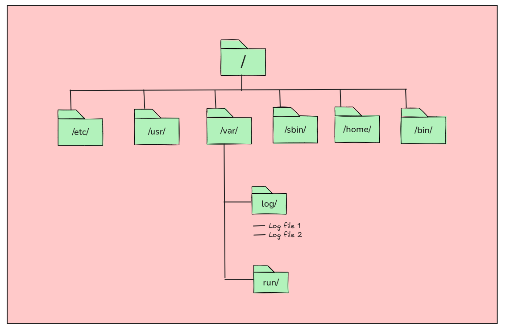
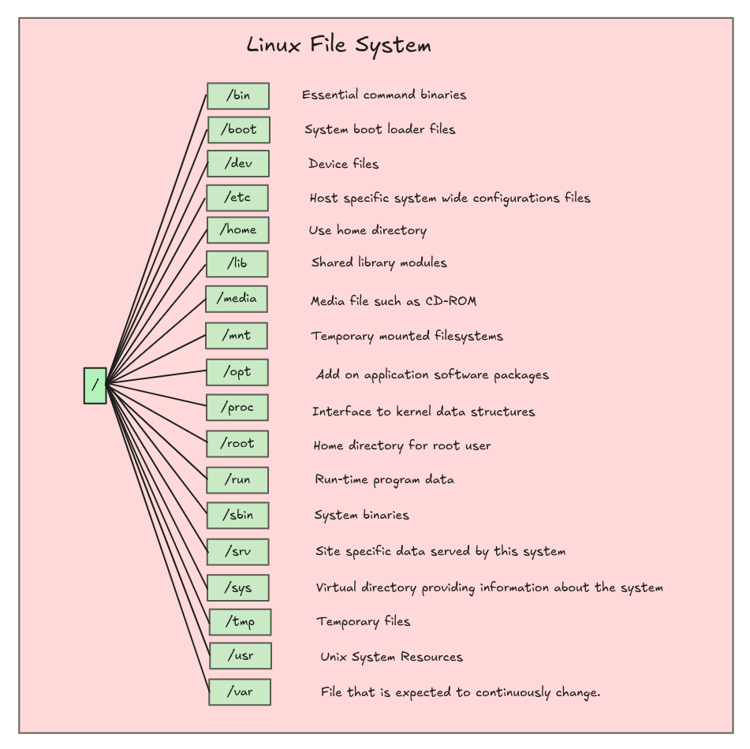

# Understanding the File System

The Linux file System is the foundation of any linux-based operating system. It dictates how files are stored, organized and accessed. Understanding this system is crucial for an DevOps engineer as it influences everything from system performance to security and deployment processes.

### 1. Introduction to the Linux File System

The Linux filesystem is a way of organizing data and files on a storage device. Unlike Windows, Linux treats everything as a file whether its a directory, a hardware device or even an active process. This unified approach simplifies interactions and makes the system highly flexible.

The Linux file system is hierarchical meaning its a root directory (**/**) from which all other files and directories branch out, forming a tree like structure. This structure is consistent across all Linux distributions, making it easier to navigate and manage multiple systems.

### 2. File System Hierarchy Standard

The File System Hierarchy Standard (FHS) defines the directory contents in Linux systems. Adherence to FHSensures that software behaves predictably across different Linux distributions.

The root directory (**/**) serves as the starting point of the filesystem. 
Key subdirectories include:

